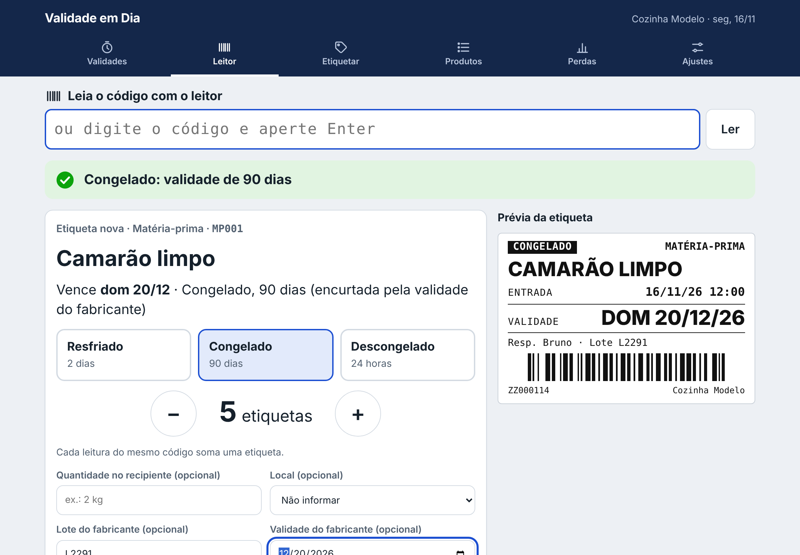
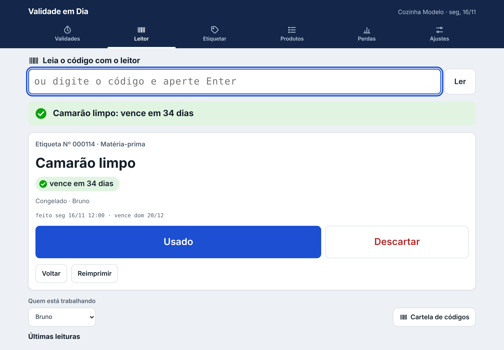
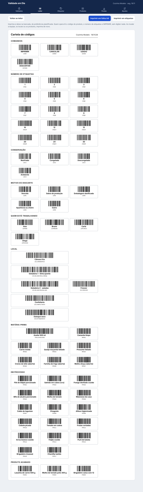

# Validade em Dia — entrada, etiquetagem e controle de validade (esboço)

Esboço de um aplicativo de controle de validade no estilo dos sistemas de
etiquetagem para cozinhas profissionais (a referência foi o Suflex), pensado
para uma empresa pequena de alimentos: tudo o que entra (matéria-prima), o
que está em processo e o que fica pronto para embalar recebe uma etiqueta com
a validade calculada, e o app passa a acompanhar o que vence. A operação do
dia a dia é feita com um leitor de código de barras, sem digitar. Nome,
visual e código são próprios.

Endereço (depois de publicado): https://teppeyochi-ui.github.io/app-alimentos/controle-validade/



É um esboço navegável: abre com dados de exemplo, tudo funciona de verdade,
mas os dados ficam só no aparelho. O que falta para virar produto está em
[Próximos passos](#próximos-passos).

## O que já faz

| Aba | O que faz |
|---|---|
| Validades | Painel das etiquetas ativas em quatro situações: vencidos, vencem hoje, vencem em breve e no prazo. Busca (produto, código, local, número), filtros por tipo e por local, baixa como **Usado** ou **Descartar** (com motivo) e reimpressão. Atualiza sozinho com o relógio. |
| Leitor | A tela de quem opera. Lê o código do produto e imprime as etiquetas; lê uma etiqueta já impressa e dá baixa. Letras e botões grandes, uma coisa por vez, som de confirmação. Daqui sai a **cartela de códigos**. |
| Etiquetar | O mesmo que o Leitor faz, tocando na tela: produto, conservação, local, responsável, quantidade, data retroativa. |
| Produtos | Catálogo por tipo (matéria-prima, em processo, produto acabado). Cada produto tem o **código da casa**, o grupo e a validade em até quatro modos: resfriado, congelado, descongelado e ambiente, em dias ou horas. |
| Perdas | Etiquetas emitidas, usadas e descartadas em 7 ou 30 dias, aproveitamento, descartes por motivo, produtos mais descartados e as últimas baixas. Exporta planilha (CSV). |
| Ajustes | Nome da casa, impressora e tamanho da etiqueta, tamanho das letras, som, dias de alerta, regra de contagem dos dias, locais, equipe, cópia de segurança. |

## Operação com o leitor

O leitor de código de barras USB funciona como um teclado: digita o código e
aperta Enter. O app entende três coisas e reage a cada uma:

| O que foi lido | O que acontece |
|---|---|
| Código de um produto (da cartela ou da caixa do fornecedor) | Começa uma etiqueta nova desse produto, com a validade já calculada. |
| Etiqueta já impressa pelo app | Abre a etiqueta para dar baixa como usada ou descartada. |
| Comando da cartela (IMPRIMIR, quantidade, conservação…) | Vale para o que está na tela. |

**Recebimento (matéria-prima).** Chegou a compra:

1. Ler o código do produto. A tela mostra o nome em letras grandes e quando vence.
2. Ler de novo o mesmo código soma uma etiqueta; ou ler o número na cartela (1, 2, 3… 30).
3. Opcional: ler a conservação (resfriado, congelado…), digitar o lote e a
   validade do fabricante. A etiqueta nunca passa da validade do fabricante.
4. Ler **IMPRIMIR**. As etiquetas saem, cada uma com o seu número em barras.

**Produto em processo e produto acabado.** Igual, com um passo a mais que é
opcional: depois de ler o código do produto, ler a etiqueta do que foi usado
para fazê-lo. O app guarda a origem ("Feito com Nº 000115"), e ela aparece no
painel e na planilha: é o rastro da matéria-prima até o produto pronto.

**Baixa.** Ler a etiqueta do item e depois **USADO** ou **DESCARTAR** (o
descarte pede o motivo, que também está na cartela).

Detalhes que evitam erro:

- Nada é registrado antes do IMPRIMIR. Ler outro produto no meio é recusado
  com um aviso, e o que estava preenchido continua na tela.
- Código que o app não conhece vira um botão "Cadastrar este código": o
  cadastro abre com o código preenchido e, ao salvar, a etiqueta já segue.
- O leitor funciona de qualquer aba. O Enter dele nunca aperta o botão que
  estiver em foco.
- "Quem está trabalhando" é lido uma vez (cada pessoa tem o seu código na
  cartela) e vale para as etiquetas e baixas seguintes.



### Cartela de códigos

Em **Leitor → Cartela de códigos**. É uma folha com os comandos, os números
de etiquetas, a conservação, os motivos de descarte, a equipe, os locais e
todos os produtos que têm código, cada um com o seu código de barras. Imprime
em folha A4 (numa impressora comum, ou "Salvar como PDF") ou em etiquetas, na
própria impressora térmica. Fica na bancada, de preferência plastificada.
Mudou a equipe, os locais ou os produtos: imprima de novo.



### Os códigos

- **Código do produto:** é o da casa, do jeito que ela já usa. Até 20
  caracteres: letras sem acento, números e `- . / _`. Pode ser também o
  código de barras da caixa do fornecedor.
- **Códigos do app:** começam todos com `ZZ` e só têm letras maiúsculas e
  números, que saem iguais em qualquer teclado. Por isso nenhum código de
  produto pode começar com `ZZ`.

| Código | Significado |
|---|---|
| `ZZ000123` | Etiqueta nº 123 |
| `ZZOK` · `ZZNAO` | Imprimir · Cancelar |
| `ZZUSO` · `ZZFORA` | Usado · Descartar |
| `ZZQ5` | 5 etiquetas |
| `ZZC1` a `ZZC4` | Resfriado, congelado, descongelado, ambiente |
| `ZZM1` a `ZZM5` | Motivo do descarte |
| `ZZPANA` · `ZZLFREEZER` | Pessoa "Ana" · Local "Freezer" |

As barras são Code 128. Se os códigos da casa tiverem `-` ou `/`, vale
conferir se o leitor está configurado para teclado ABNT2 (o manual do leitor
traz um código de configuração para isso); letras e números não dependem dessa
configuração.

## Impressora (Zebra GC420)

A GC420 imprime a 203 dpi (8 pontos por milímetro), até 104 mm de largura. O
app usa a impressão do navegador, uma etiqueta por página no tamanho do rolo,
e desenha as barras num número inteiro de pontos para saírem nítidas.

1. **Instale o driver da Zebra no Windows** (página de suporte da GC420 no
   site da Zebra). A impressora passa a aparecer em Configurações →
   Bluetooth e dispositivos → Impressoras e scanners.
2. **Diga ao driver o tamanho da etiqueta:** clique na Zebra → Preferências
   de impressão e informe largura e altura da etiqueta do rolo. No mesmo
   lugar fica o tipo de papel: térmico direto (GC420d) ou transferência
   térmica com fita (GC420t).
3. **Calibre o papel**, como está no manual, para a impressora achar o
   começo de cada etiqueta.
4. No app, em **Ajustes → Impressora e etiqueta**, escolha o mesmo tamanho
   (ou "Outro tamanho", em milímetros) e toque em **Imprimir etiqueta de teste**.
5. **Na janela de impressão do navegador:** Destino = a Zebra; em Mais
   definições, tamanho do papel igual ao da etiqueta, Margens "Nenhuma",
   Escala 100, "Cabeçalhos e rodapés" desmarcado. O navegador lembra dessa
   escolha.
6. **Confira com o leitor:** na aba Leitor, leia a etiqueta de teste.
   Aparecendo "Etiqueta de teste lida", impressora e leitor estão certos.

**Sem a janela de impressão a cada etiqueta (opcional).** Com a Zebra como
impressora padrão do Windows, crie um atalho do Chrome para o endereço do app
com `--kiosk-printing` no fim do campo Destino do atalho. O Chrome passa a
imprimir direto na impressora padrão. Em algumas versões é preciso abrir
também em modo quiosque (`--kiosk`); teste na máquina antes de adotar. A
cartela em A4 vai para outra impressora, então imprima-a abrindo o app pelo
Chrome normal.

## Como a validade é calculada

- **Em dias:** vence no fim do dia, *n* dias depois do preparo ou da entrada.
  Feito na segunda com 3 dias, vence na quinta às 23:59.
- **Regra do 1º dia** (Ajustes): se ligada, o dia do preparo conta como o
  primeiro. O mesmo produto passa a vencer na quarta.
- **Em horas:** vence na hora exata, e a etiqueta mostra a hora.
- **Validade do fabricante:** informada, é o teto da etiqueta. Se já venceu,
  o app recusa a etiqueta.
- **Situação no painel:** vencido, vence hoje, vence em breve (dentro dos
  dias de alerta, 2 por padrão) e no prazo.

Os códigos e os prazos do catálogo de exemplo são ilustrativos. Cada casa usa
os seus códigos e define os prazos com o responsável técnico e as regras da
vigilância sanitária local.

## Instalar no computador, celular ou tablet

| Aparelho | Como |
|---|---|
| Computador (Chrome/Edge) | Ícone de instalar na barra de endereço. |
| Android (Chrome) | Abra o endereço e toque em **Instalar** (ou menu **⋮** → **Instalar app**). |
| iPhone/iPad (Safari) | Abra o endereço, toque em **Compartilhar** e em **Adicionar à Tela de Início**. |

Depois de instalado, abre sem internet. O endereço terminado em `#leitor`
abre direto na tela do leitor.

## Próximos passos

1. **Carregar a tabela de códigos da casa** de uma planilha, em vez de
   cadastrar produto por produto.
2. **Contas e dados na nuvem.** Hoje cada aparelho tem os seus dados. Com um
   banco (o Supabase já usado no Diário da Linha Skin serve), o computador da
   recepção e o do escritório enxergam o mesmo painel, com login por pessoa.
3. **Recebimento completo:** fornecedor, nota fiscal, temperatura de chegada
   e conferência do que foi comprado.
4. **Baixa parcial e saldo:** hoje a etiqueta é usada inteira ou descartada
   inteira; com peso ou unidades, o app passa a saber o estoque.
5. **Impressão direta em ZPL** (a linguagem da Zebra), sem passar pela janela
   do navegador e mais rápida em lote.
6. **Alertas fora do app:** notificação ou e-mail de manhã com o que vence no dia.
7. **Mais dados na etiqueta e no catálogo:** alergênicos, ingredientes, peso
   líquido, modelos de etiqueta por tipo de produto.
8. **Perdas em peso e em dinheiro** (hoje o relatório conta etiquetas).

## Como está montado

Sem etapa de build e sem dependências: HTML, CSS e JavaScript puros, como os
outros apps estáticos deste repositório.

| Arquivo | Papel |
|---|---|
| `core.js` | Regras, sem tela: validade, situação, baixas, relatório, planilha, código de barras (Code 128), a lógica do leitor passo a passo, a cartela e os dados de exemplo. Roda também no Node. |
| `app.js` | Telas e eventos. |
| `styles.css` | Visual (tema claro e escuro), a etiqueta e a cartela, na tela e no papel. |
| `sw.js`, `manifest.webmanifest`, `icones/` | Instalação e uso sem internet. |

Os dados ficam no `localStorage` do aparelho, na chave `validade_em_dia_v1`:
ajustes, catálogo e etiquetas. Cada etiqueta guarda produto (nome, código e
tipo), conservação, local, responsável, entrada ou preparo, validade, as
etiquetas de origem e, depois da baixa, se foi usada ou descartada, quando,
por quem e por quê.

## Testes

```bash
node teste-nucleo.js                 # regras, código de barras e leitor (30 testes, sem navegador)
node teste-interface.js              # telas no Chromium, com a data fixa (25 testes)
node teste-interface.js --capturas   # o mesmo, regravando as imagens de capturas/
```

O teste do núcleo roda na publicação: se uma regra quebrar, o site não é
atualizado. As barras são conferidas contra uma biblioteca de referência
(JsBarcode); as etiquetas e a cartela, desenhadas na resolução da impressora,
foram lidas de volta por um decodificador (ZXing). Falta a prova no papel, com
a Zebra e o leitor da casa.
