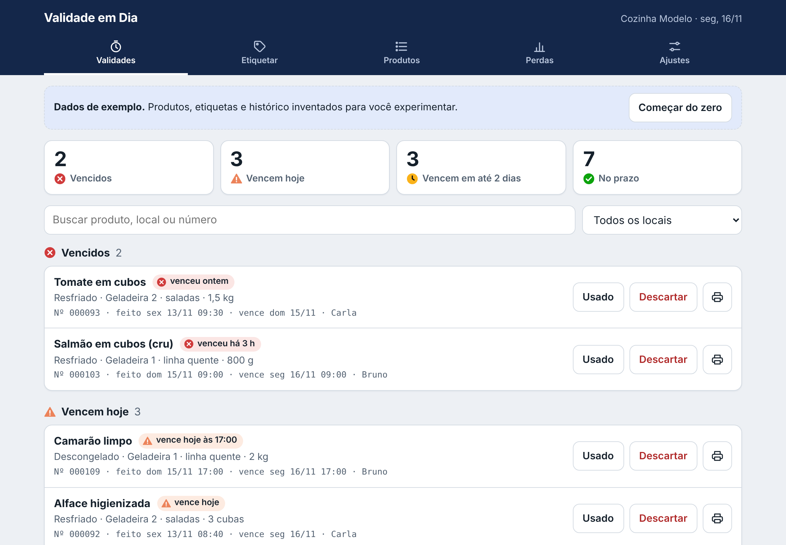
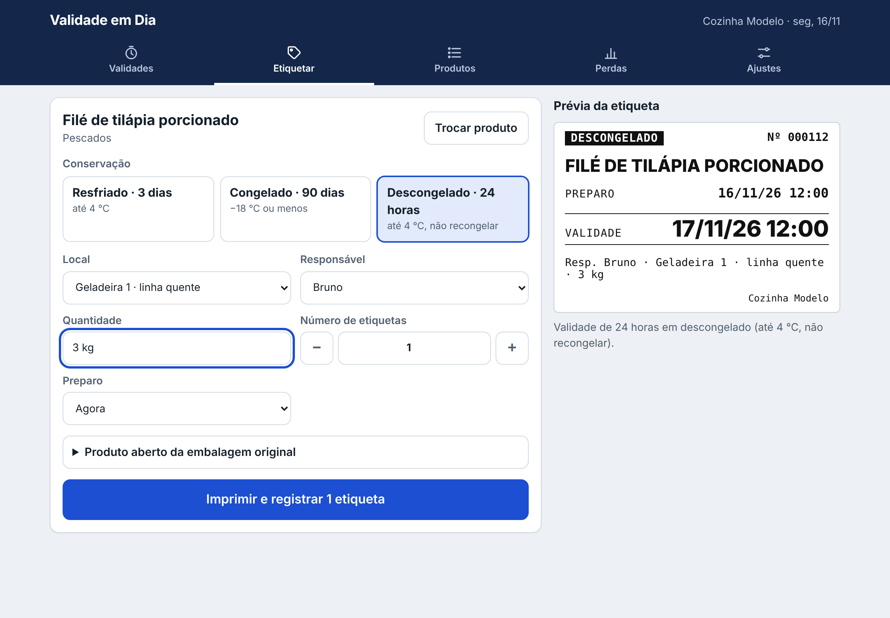

# Validade em Dia — controle de validade para cozinhas (esboço)

Primeiro esboço de um aplicativo de controle de validade no estilo dos sistemas
de etiquetagem para cozinhas profissionais (a referência foi o Suflex): a
equipe escolhe o produto, o app calcula a validade, imprime a etiqueta e passa
a acompanhar o que vence. Nome, visual e código são próprios.

Endereço (depois de publicado): https://teppeyochi-ui.github.io/app-alimentos/controle-validade/



É um esboço navegável: abre com dados de exemplo, tudo funciona de verdade,
mas os dados ficam só no aparelho. O que falta para virar produto está em
[Próximos passos](#próximos-passos).

## O que já faz

| Aba | O que faz |
|---|---|
| Validades | Painel das etiquetas ativas em quatro situações: vencidos, vencem hoje, vencem em breve e no prazo. Busca, filtro por local, baixa como **Usado** ou **Descartar** (com motivo) e reimpressão. Atualiza sozinho com o relógio. |
| Etiquetar | Escolhe o produto, o modo de conservação, local, responsável, quantidade e número de etiquetas. A prévia mostra a etiqueta com a validade já calculada. **Imprimir e registrar** manda para a impressora e coloca as etiquetas no painel, cada uma com o seu número. |
| Produtos | Catálogo por grupo. Cada produto tem a validade em até quatro modos: resfriado, congelado, descongelado e ambiente, em dias ou horas. |
| Perdas | Etiquetas emitidas, usadas e descartadas em 7 ou 30 dias, aproveitamento, descartes por motivo, produtos mais descartados e as últimas baixas. Exporta planilha (CSV). |
| Ajustes | Nome da casa, tamanho da etiqueta (60 × 40, 50 × 30 ou 100 × 50 mm), dias de alerta, regra de contagem dos dias, locais, equipe, cópia de segurança. |



### Como a validade é calculada

- **Em dias:** vence no fim do dia, *n* dias depois do preparo. Feito na
  segunda com 3 dias, vence na quinta às 23:59.
- **Regra do 1º dia** (Ajustes): se ligada, o dia do preparo conta como o
  primeiro. O mesmo produto passa a vencer na quarta.
- **Em horas:** vence na hora exata (24 horas depois das 14:32 é 14:32 do dia
  seguinte), e a etiqueta mostra a hora.
- **Produto aberto da embalagem original:** informando a validade do
  fabricante, a etiqueta nunca passa dela. Se o fabricante já venceu, o app
  recusa a etiqueta.
- **Situação no painel:** vencido (passou da hora), vence hoje, vence em breve
  (dentro dos dias de alerta, 2 por padrão) e no prazo.

Os prazos do catálogo de exemplo são ilustrativos. Cada casa define os seus
com o responsável técnico e as regras da vigilância sanitária local.

### Impressão

O app usa a impressão do próprio navegador: cada etiqueta sai numa página do
tamanho do rolo escolhido nos Ajustes. Com a impressora térmica instalada no
tablet ou no computador, basta escolhê-la na janela de impressão (margens
"nenhuma", escala 100%).

## Instalar no celular ou tablet

| Aparelho | Como |
|---|---|
| Android (Chrome) | Abra o endereço e toque em **Instalar** (ou menu **⋮** → **Instalar app**). |
| iPhone/iPad (Safari) | Abra o endereço, toque em **Compartilhar** e em **Adicionar à Tela de Início**. |
| Computador (Chrome/Edge) | Ícone de instalar na barra de endereço. |

Depois de instalado, abre sem internet.

## Próximos passos

O que os sistemas comerciais desse tipo anunciam e este esboço ainda não tem,
em ordem sugerida:

1. **Contas e dados na nuvem.** Hoje cada aparelho tem os seus dados. Com um
   banco (o Supabase já usado no Diário da Linha Skin serve), a cozinha
   inteira enxerga o mesmo painel, com login por pessoa e mais de uma unidade.
2. **QR code na etiqueta e leitura pela câmera** para dar baixa apontando o
   celular, sem procurar o item na lista.
3. **Impressora térmica direta** (Bluetooth ou rede), para imprimir sem a
   janela do navegador e em lote mais rápido.
4. **Alertas fora do app:** notificação ou e-mail de manhã com o que vence no dia.
5. **Recebimento de mercadorias:** conferência na chegada (fornecedor, lote,
   validade, temperatura) já gerando as etiquetas.
6. **Contagem de estoque** e **controle de produção** do dia a partir das
   mesmas etiquetas.
7. **Mais dados na etiqueta e no catálogo:** alergênicos, ingredientes,
   modelos de etiqueta por tipo de produto.
8. **Perdas em peso e em dinheiro** (hoje o relatório conta etiquetas), com
   custo por produto.

## Como está montado

Sem etapa de build e sem dependências: HTML, CSS e JavaScript puros, como os
outros apps estáticos deste repositório.

| Arquivo | Papel |
|---|---|
| `core.js` | Regras, sem tela: cálculo da validade, situação, baixas, relatório, planilha, dados de exemplo. Roda também no Node. |
| `app.js` | Telas e eventos. |
| `styles.css` | Visual (tema claro e escuro) e a folha de impressão da etiqueta. |
| `sw.js`, `manifest.webmanifest`, `icones/` | Instalação e uso sem internet. |

Os dados ficam no `localStorage` do aparelho, na chave `validade_em_dia_v1`:
ajustes, catálogo de produtos e etiquetas (cada etiqueta guarda produto,
conservação, local, responsável, preparo, validade e, depois da baixa, se foi
usada ou descartada, quando, por quem e por quê).

## Testes

```bash
node teste-nucleo.js                 # regras (20 testes, sem navegador)
node teste-interface.js              # telas no Chromium, com a data fixa (16 testes)
node teste-interface.js --capturas   # o mesmo, regravando as imagens de capturas/
```

O teste do núcleo roda na publicação: se uma regra quebrar, o site não é atualizado.
