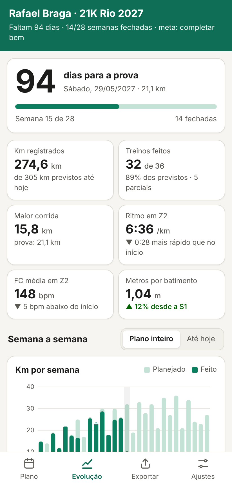

# 21K Rio 2027 — plano de treino

Aplicativo do plano de 28 semanas para a meia maratona do Rio (29/05/2027):
registro de cada treino, painel de evolução e relatório semanal para colar na
conversa com o Claude. Instala no celular e funciona sem internet.

Depois de publicado: https://teppeyochi-ui.github.io/app-alimentos/treino-21k/

## Instalar no celular

| Aparelho | Como |
|---|---|
| Android (Chrome) | Abra o endereço acima e toque em **Instalar** na faixa que aparece (ou menu **⋮** → **Instalar app**). |
| iPhone (Safari) | Abra o endereço acima, toque em **Compartilhar** e em **Adicionar à Tela de Início**. |
| Computador (Chrome/Edge) | Ícone de instalar na barra de endereço. |

O passo a passo também fica na aba **Ajustes** do próprio app.

## Como usar

| Aba | O que faz |
|---|---|
| Plano | As 28 semanas. Toque no treino para registrar km, tempo, FC, esforço, tênis, hidratação e dor. Ao terminar a semana, toque em **Fechar semana**. |
| Evolução | Painel com a contagem regressiva, os indicadores e os gráficos semana a semana (abaixo). |
| Exportar | Junta o prompt atual com os relatórios das semanas fechadas e ainda não enviadas. Copie, cole no Claude e marque como enviadas. |
| Ajustes | Instalação, prompt atual, km anteriores do Evo SL, backup e restauração. |

### Painel de evolução

- **Indicadores**: dias para a prova, km registrados contra o previsto até hoje,
  treinos feitos, maior corrida, ritmo e FC nas rodagens Z2 e metros por batimento.
- **Km por semana**: coluna clara = planejado, coluna escura = feito.
- **Maior corrida da semana**: o longão subindo até os 21,1 km da prova.
- **Rodagens leves (Z2)**: ritmo, FC média e metros por batimento (quanto se corre
  a cada batimento do coração; subindo, o condicionamento está melhorando).
- **Como o corpo respondeu**: esforço médio, dor mais forte da semana (4 ou mais
  é sinal vermelho) e sono/cansaço informado ao fechar a semana.
- **Testes de suor** e **tênis** (km do Evo SL contra a vida útil de ~720 km).

Tocar num gráfico mostra os valores da semana; **Ver números** abre a tabela.
O seletor **Plano inteiro / Até hoje** troca o recorte de todos os gráficos.

## Dados e backup

- Os registros ficam **só no aparelho** (armazenamento do navegador). Nada é
  enviado para a internet.
- Trocar de celular, limpar os dados do navegador ou desinstalar o app apaga os
  registros: use **Ajustes → Backup** de vez em quando (arquivo ou texto).
- O backup da página antiga (o arquivo HTML único) tem o mesmo formato: gere o
  texto lá, cole em **Ajustes → Backup** e toque em **Restaurar do texto**.

## Diferenças em relação à página original

- A tecla Enter do teclado salva o treino (antes, fechava sem salvar).
- Os longões com teste de suor (S5 e S10) contam como rodagem Z2 nas médias.
- Dor registrada num treino marcado como "não fiz" entra no alerta e no relatório.

## Arquivos

| Arquivo | Conteúdo |
|---|---|
| `index.html`, `styles.css`, `app.js` | Interface. |
| `core.js` | Núcleo: plano, datas, cálculos, relatório e números do painel. |
| `graficos.js` | Desenho dos gráficos em SVG. |
| `sw.js`, `manifest.webmanifest`, `icones/` | Instalação como app e uso sem internet (mude `VERSION` em `sw.js` a cada atualização). |
| `teste-nucleo.js` | Testes do núcleo: `node teste-nucleo.js`. |
| `teste-interface.js` | Testes da interface no Chromium: `node teste-interface.js` (`--capturas` regrava as imagens de `capturas/`). |
| `ferramentas/` | Ícone em SVG e gerador dos PNG. |

Para rodar localmente: `python3 -m http.server` dentro desta pasta e abrir
`http://localhost:8000`.

Para mudar o plano, edite a lista `PLANO` no começo de `core.js` (as datas saem
de `INICIO`) e rode os testes.
