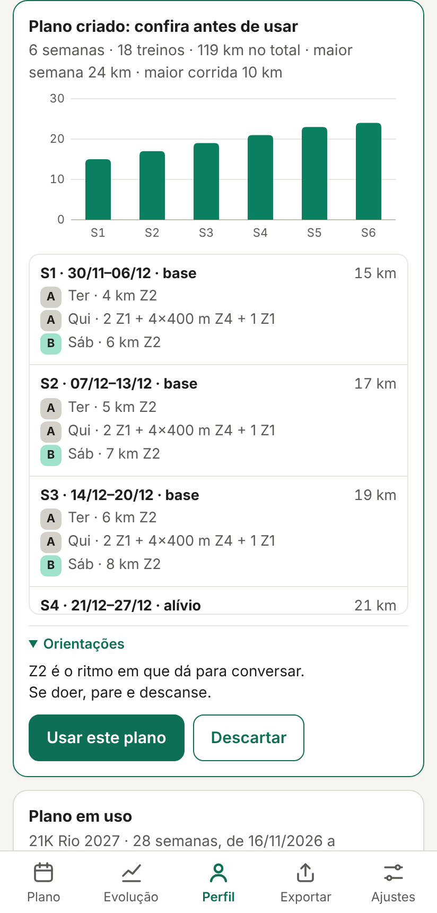

# 21K Rio 2027 — plano de treino

Aplicativo de treino de corrida: plano semana a semana, registro de cada
treino, painel de evolução e relatório semanal para colar na conversa com o
Claude. Tem um perfil com objetivo e cria o treino com IA. Instala no celular e
funciona sem internet (a criação do treino pela IA precisa de internet).

Endereço: https://teppeyochi-ui.github.io/app-alimentos/treino-21k/

O app nasceu com o plano de 28 semanas para a meia maratona do Rio
(29/05/2027). Esse plano continua embutido e vale até alguém criar outro na
aba Perfil.

## Instalar no celular

| Aparelho | Como |
|---|---|
| Android (Chrome) | Abra o endereço acima e toque em **Instalar** na faixa que aparece (ou menu **⋮** → **Instalar app**). |
| iPhone (Safari) | Abra o endereço acima, toque em **Compartilhar** e em **Adicionar à Tela de Início**. |
| Computador (Chrome/Edge) | Ícone de instalar na barra de endereço. |

O passo a passo também fica na aba **Ajustes** do próprio app.

## Como usar

| Aba | O que faz |
|---|---|
| Plano | As semanas do plano em uso. Toque no treino para registrar km, tempo, FC, esforço, tênis, hidratação e dor. Ao terminar a semana, toque em **Fechar semana**. |
| Evolução | Painel com a contagem regressiva, os indicadores e os gráficos semana a semana. |
| Perfil | Cadastro de quem corre, estado físico na corrida, tênis e objetivo. É onde o treino é criado pela IA. |
| Exportar | Junta o prompt atual com os relatórios das semanas fechadas e ainda não enviadas. Copie, cole no Claude e marque como enviadas. |
| Ajustes | Instalação, chave da IA, prompt atual, backup e restauração. |

### Perfil, objetivo e treino criado pela IA

1. Preencha a aba **Perfil**: dados principais, estado físico (há quanto tempo
   corre, km por semana, maior corrida recente, ritmo confortável, dias
   disponíveis, lesões) e o **objetivo** (prova, distância, data, meta). Tudo é
   guardado sozinho a cada campo.
2. Toque em **Criar treino com IA**. O app envia o perfil (sem o nome) e o
   objetivo ao Claude e mostra o andamento.
3. Confira a **prévia**: km por semana, lista dos treinos e orientações. Nada
   muda antes de tocar em **Usar este plano**.
4. Com o plano novo em uso, o Plano, a Evolução e o Exportar passam a
   trabalhar com ele. Os registros do plano antigo saem da tela; **Voltar ao
   plano anterior** (aba Perfil) desfaz a troca.

O plano tem de 4 a 40 semanas, da segunda de início até a semana da prova, que
é sempre o último treino. Mudar o objetivo no Perfil não mexe no plano em uso:
ele só passa a valer num treino novo.

É orientação geral de treino e não substitui avaliação médica.

### Chave de API

A IA usa a API do Claude e precisa de uma chave da Anthropic
(console.anthropic.com), informada em **Ajustes → IA (Claude)**. O uso é
cobrado na conta da Anthropic de quem informou a chave.

- A chave fica guardada só no navegador do aparelho, fora do backup, e é
  enviada apenas à Anthropic. Não use em aparelho compartilhado.
- Modelos: Claude Opus 5.5 (padrão), Sonnet 5.5 ou Haiku 5.5.
- **Sem chave**: em Perfil → Criar treino com IA → "Sem chave de API", copie o
  pedido, cole numa conversa em claude.ai e cole a resposta de volta. A prévia
  e o resto funcionam igual.

### Painel de evolução

- **Indicadores**: dias para a prova, km registrados contra o previsto até hoje,
  treinos feitos, maior corrida, ritmo e FC nas rodagens Z2 e metros por batimento.
- **Km por semana**: coluna clara = planejado, coluna escura = feito.
- **Maior corrida da semana**: o longão subindo até a distância da prova.
- **Rodagens leves (Z2)**: ritmo, FC média e metros por batimento (quanto se corre
  a cada batimento do coração; subindo, o condicionamento está melhorando).
- **Como o corpo respondeu**: esforço médio, dor mais forte da semana (4 ou mais
  é sinal vermelho) e sono/cansaço informado ao fechar a semana.
- **Testes de suor** e **tênis** (km de cada tênis do perfil contra a vida útil).

Tocar num gráfico mostra os valores da semana; **Ver números** abre a tabela.
O seletor **Plano inteiro / Até hoje** troca o recorte de todos os gráficos.

## Dados e backup

- Os registros, o perfil e o plano ficam **só no aparelho** (armazenamento do
  navegador). Só saem dele quando a pessoa cria um treino com a IA (perfil sem
  o nome e objetivo, para a Anthropic).
- Trocar de celular, limpar os dados do navegador ou desinstalar o app apaga
  tudo: use **Ajustes → Backup** de vez em quando (arquivo ou texto). O backup
  leva o perfil e o plano criado, mas não a chave da IA.
- O backup da página antiga (o arquivo HTML único) tem o mesmo formato: gere o
  texto lá, cole em **Ajustes → Backup** e toque em **Restaurar do texto**.

## Diferenças em relação à página original

- A tecla Enter do teclado salva o treino (antes, fechava sem salvar).
- Os longões com teste de suor (S5 e S10) contam como rodagem Z2 nas médias.
- Dor registrada num treino marcado como "não fiz" entra no alerta e no relatório.
- Os km que o Evo SL já tinha agora ficam na lista de tênis do Perfil.

## Arquivos

| Arquivo | Conteúdo |
|---|---|
| `index.html`, `styles.css`, `app.js` | Interface. |
| `core.js` | Núcleo: plano embutido, plano criado, perfil, datas, cálculos, relatório e números do painel. |
| `ia.js` | IA: pedido do plano ao Claude, chamada à API, leitura do streaming e mensagens de erro. |
| `graficos.js` | Desenho dos gráficos em SVG. |
| `sw.js`, `manifest.webmanifest`, `icones/` | Instalação como app e uso sem internet (mude `VERSION` em `sw.js` a cada atualização). |
| `teste-nucleo.js` | Testes do núcleo e da IA, sem navegador: `node teste-nucleo.js`. |
| `teste-interface.js` | Testes da interface no Chromium, com a API do Claude simulada: `node teste-interface.js` (`--capturas` regrava as imagens de `capturas/`). |
| `ferramentas/` | Ícone em SVG e gerador dos PNG. |

Um arquivo novo do app precisa entrar em três lugares: na página
(`index.html`), no cache (`APP_SHELL` em `sw.js`) e na cópia do workflow
(`.github/workflows/pages-classificador.yml`). O teste da interface confere os três.

Para rodar localmente: `python3 -m http.server` dentro desta pasta e abrir
`http://localhost:8000`.

Para mudar o plano embutido, edite a lista `PLANO_21K` no começo de `core.js`
(as datas saem de `INICIO_21K`) e rode os testes.
